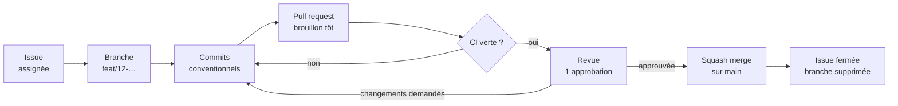

# Contribuer à Upshift Agents

Merci de votre intérêt ! Ce guide vaut pour l'équipe du projet comme pour toute personne extérieure. Il décrit le parcours d'une contribution, de l'issue à la fusion.

> Première fois ? Lisez d'abord le [parcours d'arrivée du wiki](https://github.com/exceev-technology/upshift-agent/wiki/Parcours-d-arrivee) : comptes, installation et première pull request pas à pas.

## Sommaire

- [Avant de commencer](#avant-de-commencer)
- [Trouver quoi faire](#trouver-quoi-faire)
- [Installer le projet](#installer-le-projet)
- [Le parcours d'une contribution](#le-parcours-dune-contribution)
- [Branches et commits](#branches-et-commits)
- [Ouvrir une pull request](#ouvrir-une-pull-request)
- [Relire une pull request](#relire-une-pull-request)
- [Fusion et publication](#fusion-et-publication)
- [Libellés](#libellés)
- [Contribuer depuis un fork](#contribuer-depuis-un-fork)
- [Licence des contributions](#licence-des-contributions)

## Avant de commencer

- Respectez le [code de conduite](CODE_OF_CONDUCT.md).
- Lisez [AGENTS.md](AGENTS.md) : règles du projet, du SDK, conventions de nommage et Definition of Done. Les agents de code (Claude Code, Codex, Cursor…) le lisent aussi.
- **Questions** : dans les [Discussions](https://github.com/exceev-technology/upshift-agent/discussions), pas dans les issues.
- **Failles de sécurité** : jamais en public, voir [SECURITY.md](SECURITY.md).
- **Données** : fictives ou anonymisées uniquement. **Secrets** : jamais dans le dépôt, les issues, le wiki ou Slack.

## Trouver quoi faire

| Où | Pour |
| --- | --- |
| [Tableau du projet](https://github.com/orgs/exceev-technology/projects/2) | Le backlog et le sprint en cours (équipe) |
| [Jalons](https://github.com/exceev-technology/upshift-agent/milestones) | Une étape par sprint, avec sa date de fin et son avancement |
| [`good first issue`](https://github.com/exceev-technology/upshift-agent/labels/good%20first%20issue) | Des tâches courtes et bien décrites pour démarrer |
| [`help wanted`](https://github.com/exceev-technology/upshift-agent/labels/help%20wanted) | Des sujets ouverts à toute personne volontaire |

Avant de commencer une issue, **assignez-la-vous** (ou demandez-la en commentaire) pour éviter que deux personnes travaillent sur la même chose. Une issue sans activité depuis 2 jours ouvrés peut être réattribuée.

Pour une nouvelle idée, ouvrez une issue avec le bon modèle :

| Modèle | Quand |
| --- | --- |
| **Fonctionnalité** | Une nouvelle capacité, écrite comme une story utilisateur avec ses critères d'acceptation |
| **Bug** | Un comportement inattendu, reproductible |
| **Tâche** | Un travail technique, une configuration, de la documentation ou de l'apprentissage |

## Installer le projet

Prérequis : Node 24 (voir `.nvmrc`), Yarn 4 via Corepack, Git, et Docker si vous voulez un serveur Upshift local.

```bash
git clone https://github.com/exceev-technology/upshift-agent.git
cd upshift-agent
nvm install && nvm use
corepack enable
yarn install
```

Vérifiez que tout fonctionne :

```bash
yarn lint && yarn typecheck && yarn test:unit && yarn upshift dev:build
```

Pour relier la CLI à l'espace **ECC Upshift Agents** ou lancer un serveur local, suivez la section « Démarrer » du [README](README.md#démarrer).

## Le parcours d'une contribution



1. **Une issue, une branche, une pull request.** Pas de travail sans issue, pas de PR qui mélange plusieurs sujets.
2. Passez la carte du tableau en **In Progress** quand vous commencez, **In Review** quand la PR est prête.
3. Ouvrez la PR **en brouillon** dès le premier commit : l'équipe voit votre avancement et la CI tourne tôt.
4. Une PR reste petite : visez moins de 400 lignes modifiées. Au-delà, découpez.

## Branches et commits

**Branches** : `<type>/<numéro-de-l-issue>-<description-courte>`, en minuscules et en anglais.

```text
feat/12-score-prospect-tool
fix/31-duplicate-task-on-replay
docs/8-wiki-scrum-page
chore/40-update-sdk
```

Le préfixe de la branche pose automatiquement le libellé de type sur la PR.

**Commits** : [Conventional Commits](https://www.conventionalcommits.org/fr/), **en anglais**, à l'impératif, sans majuscule ni point final.

```text
feat: add score-prospect tool
fix(contracts): reject replayed intent with different params
docs: explain the review checklist
```

| Type | Pour |
| --- | --- |
| `feat` | Une nouvelle capacité |
| `fix` | Une correction |
| `docs` | Documentation, wiki |
| `test` | Des tests seuls |
| `refactor` | Une réécriture sans changement de comportement |
| `perf` | Une amélioration de performance |
| `build`, `ci` | Dépendances, build, workflows |
| `chore` | Maintenance diverse |
| `revert` | L'annulation d'un commit |

Ajoutez `!` après le type (`feat!:`) pour un changement incompatible, et expliquez-le dans le corps.

Gardez votre branche à jour avec `main` :

```bash
git fetch origin
git rebase origin/main
git push --force-with-lease
```

## Ouvrir une pull request

- **Titre** au format Conventional Commits, en anglais : il devient le message du commit sur `main`. Un workflow le vérifie.
- **Description** en français, en suivant le modèle : ce qui change, pourquoi, comment tester, statut de la capacité.
- Liez l'issue avec `Closes #12` : elle se fermera à la fusion.
- Ajoutez le **jalon** du sprint.

Avant de demander une revue, vérifiez en local :

```bash
yarn lint && yarn typecheck && yarn test:unit && yarn upshift dev:build
```

La CI rejoue ces vérifications, puis les tests d'intégration contre une instance de test, une analyse CodeQL et une revue des dépendances. **Une PR rouge n'est pas relue.**

Règles propres au projet, rappelées dans le modèle de PR :

- un skill modifié → `version` incrémentée dans `src/catalog/skills.ts` ;
- toute écriture passe par `checkActionProposal` ;
- un `universalIdentifier` déjà synchronisé ne change jamais ;
- chaque capacité est documentée comme *prévue*, *simulée*, *testée* ou *disponible*.

## Relire une pull request

Chaque PR demande **une approbation** d'un autre membre. Les fichiers sensibles (contrats, rôles, identifiants, CI, dépendances) demandent en plus celle de l'encadrement : c'est automatique, via [`CODEOWNERS`](.github/CODEOWNERS).

**Délai** : une première réponse dans les 24 h ouvrées. Relire fait partie du travail du sprint, au même titre qu'écrire.

**Ce qu'on vérifie** :

1. **Le besoin** : la PR fait ce que dit l'issue, ni plus ni moins.
2. **La justesse** : cas limites, erreurs, refus, doublons, pannes. Pas de succès fictif.
3. **Les droits** : aucune écriture hors de `checkActionProposal`, aucun droit ajouté sans raison.
4. **Les tests** : le comportement nouveau est testé, les tests échouent sans le correctif.
5. **La lisibilité** : noms clairs, code qui ressemble au code voisin.
6. **La documentation** : README, catalogue, wiki ou CHANGELOG à jour si besoin.

**Comment commenter** : préfixez pour indiquer le poids du commentaire.

| Préfixe | Sens |
| --- | --- |
| `bloquant:` | Doit être corrigé avant la fusion |
| `question:` | Besoin de comprendre, pas forcément un changement |
| `suggestion:` | Une amélioration possible, à discuter |
| `nit:` | Détail de forme, non bloquant |

Utilisez les blocs *suggestion* de GitHub pour proposer une correction directement applicable. Approuvez quand il ne reste que des `nit:`.

L'auteur·e de la PR répond à chaque commentaire et **résout** la conversation une fois traitée : la fusion est bloquée tant qu'une conversation reste ouverte.

## Fusion et publication

- Fusion en **squash** uniquement : un commit par PR sur `main`, avec le titre de la PR.
- La branche est supprimée automatiquement après la fusion.
- `main` est protégée : pas de push direct, pas de force-push, CI verte et revue obligatoires.
- Le [CHANGELOG](CHANGELOG.md) est mis à jour dans la PR quand le changement est visible pour l'utilisateur. Les notes de version GitHub sont générées à partir des libellés.

## Libellés

| Famille | Exemples | Posé par |
| --- | --- | --- |
| `type:` | `type: fonctionnalité`, `type: bug`, `type: tâche`, `type: apprentissage` | Le modèle d'issue ou le préfixe de branche |
| `zone:` | `zone: agents`, `zone: contrats`, `zone: CI` | Automatiquement selon les fichiers modifiés |
| `priorité:` | `priorité: P0 critique` → `priorité: P3 basse` | Le Product Owner au tri |
| `taille:` | `taille: XS` → `taille: XL` | L'équipe en Sprint Planning |
| `scénario` | `scénario 1 · analyser` … `scénario 3 · coordonner` | L'équipe |
| `statut:` | `statut: à trier`, `statut: prêt`, `statut: bloqué` | Tout le monde |

Une issue `taille: XL` se découpe avant d'entrer dans un sprint. La liste complète est dans [`.github/labels.yml`](.github/labels.yml).

## Contribuer depuis un fork

Sans droit d'écriture sur le dépôt :

1. Forkez le dépôt, puis clonez votre fork.
2. Ajoutez le dépôt d'origine : `git remote add upstream https://github.com/exceev-technology/upshift-agent.git`.
3. Travaillez sur une branche, poussez sur votre fork, ouvrez la PR vers `exceev-technology/upshift-agent:main`.
4. Pour une première contribution, un membre de l'équipe approuve le lancement de la CI.

## Licence des contributions

Le projet est sous [licence Apache 2.0](LICENSE). En proposant une contribution, vous acceptez qu'elle soit publiée sous cette même licence, comme le prévoit sa section 5.
