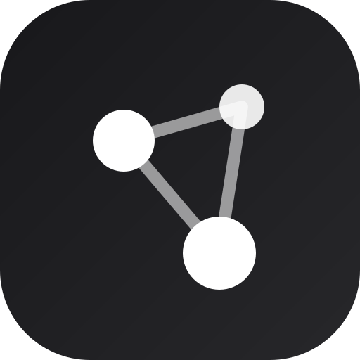
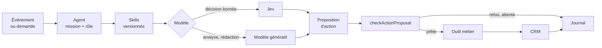

<div align="center">
  

  <h1>Upshift Agents</h1>

  <p>
    <strong>Des agents et des skills autonomes pour les processus de l'entreprise, construits comme une app Upshift.</strong><br />
    Premier cas d'application : le CRM. Rechercher, qualifier, faire avancer les affaires, sans jamais agir hors contrôle.
  </p>

  <p>
    <a href="https://github.com/exceev-technology/upshift-agent/actions/workflows/ci.yml"></a>
    <a href="https://github.com/exceev-technology/upshift-agent/actions/workflows/codeql.yml"></a>
    <a href="https://scorecard.dev/viewer/?uri=github.com/exceev-technology/upshift-agent"></a>
    <a href="LICENSE"></a>
    
    <a href="https://www.conventionalcommits.org/fr/"></a>
  </p>

  <p>
    <a href="https://github.com/exceev-technology/upshift-agent/wiki"><strong>Wiki</strong></a> ·
    <a href="CONTRIBUTING.md"><strong>Contribuer</strong></a> ·
    <a href="https://github.com/exceev-technology/upshift-agent/discussions"><strong>Discussions</strong></a> ·
    <a href="https://github.com/exceev-technology/upshift-agent/milestones"><strong>Sprints</strong></a> ·
    <a href="https://docs.upshiftcloud.com/getting-started/introduction"><strong>Documentation Upshift</strong></a>
  </p>
</div>

---

## À propos

**Upshift Agents** compose plusieurs agents et un catalogue de skills partagés pour prendre en charge les processus de l'entreprise, à l'intérieur d'Upshift. Le CRM sert de terrain d'expérimentation : rechercher des prospects, les qualifier et faire progresser les affaires jusqu'à leur conclusion. Les travaux validés serviront de base aux fonctions agentiques natives d'**Upshift Agent**.

Projet Innovation ECC 2026 · Sujet 01 · [Exceev Technology](https://github.com/exceev-technology) × École Centrale Casablanca. **Soutenance du MVP le 8 décembre 2026.**

> [!NOTE]
> **Statut : socle installé.** Le catalogue, les rôles et le contrat d'action compilent et passent leurs tests unitaires. L'app est installée sur l'espace ECC Upshift Agents depuis le 22 octobre ; aucun modèle n'y est encore appelé.

## Comment ça marche



- **Un modèle propose, le serveur dispose.** Toute écriture passe par `checkActionProposal` : action déléguée, paramètres valides, preuves vérifiées, état inchangé, approbation enregistrée, intention non rejouée.
- **Les droits viennent du rôle de l'agent**, jamais d'un skill ni d'un modèle, et ne dépassent jamais ceux de l'app.
- **Plusieurs modèles, chacun à sa place** : Jev pour classer, évaluer et vérifier ; des modèles génératifs pour analyser et rédiger.
- **Pas de succès fictif** : une panne, un budget épuisé ou une donnée manquante produit un état explicite.

## Contenu et statut

| Élément | Où | Statut |
| --- | --- | --- |
| 4 agents : A · Acquisition, B · Qualification, C · Engagement, D · Affaires | `src/agents/`, `src/catalog/agents.ts` | prévu |
| 8 skills réutilisables, S1 à S8 (S3 et S4 partagés) | `src/skills/`, `src/catalog/skills.ts` | prévu |
| Rôle de l'application et délégation de chaque agent | `src/roles/` | prévu |
| Contrat d'action typé, contrôlé avant exécution | `src/contracts/` | testé en unitaire |
| Jev (TypeSafe AI) et modèles génératifs | fournisseurs IA de l'espace, `src/models/providers.ts` | à activer |
| Outils, déclencheurs, objets CRM, supervision | — | à construire |

Chaque capacité est *prévue*, *simulée*, *testée* ou *disponible*. Un simulateur ne valide jamais une intégration réelle.

## Démarrer

Prérequis : Node 24 (`.nvmrc`), Yarn 4 via Corepack, Docker pour un serveur local (facultatif), un accès à l'espace **ECC Upshift Agents**.

```bash
git clone https://github.com/exceev-technology/upshift-agent.git
cd upshift-agent
nvm install && nvm use
corepack enable
yarn install
```

Vérifier le socle :

```bash
yarn lint && yarn typecheck && yarn test:unit && yarn upshift dev:build
```

Tests d'intégration, contre un serveur de test et avec sa clé dans l'environnement, jamais dans le dépôt :

```bash
UPSHIFT_API_KEY=<clé-de-l-espace-de-test> yarn test
```

Relier la CLI à l'espace, avec l'adresse et la clé fournies par l'encadrement, puis prévisualiser avant de synchroniser :

```bash
yarn upshift remote:add --url <adresse-de-l-espace> --as ecc
yarn upshift plan
```

```bash
yarn upshift apply
```

Activez ensuite les fournisseurs IA (dont TypeSafe AI pour Jev) avec leur clé dans les réglages IA de l'espace. Aucune clé n'est écrite dans le dépôt.

## Commandes

| Tâche | Commande |
| --- | --- |
| Lint | `yarn lint` |
| Typecheck | `yarn typecheck` |
| Tests unitaires | `yarn test:unit` |
| Tests d'intégration (serveur et clé requis) | `UPSHIFT_API_KEY=<clé> yarn test` |
| Construire l'app et vérifier le manifeste | `yarn upshift dev:build` |
| Prévisualiser une synchronisation | `yarn upshift plan` |
| Synchroniser avec l'espace actif | `yarn upshift apply` |
| Serveur local (Docker) | `yarn upshift docker:start` |
| Exécuter une fonction | `yarn upshift dev:function:exec -n <nom> -p '{"k":"v"}'` |
| Suivre les journaux des fonctions | `yarn upshift dev:function:logs` |

## Structure du dépôt

```text
src/
  application-config.ts   Application et logo
  catalog/                Contrats des skills et fiches des agents (source de vérité)
  skills/  agents/        Une entité par skill et par agent, rendue depuis le catalogue
  roles/                  Rôle de l'application (plafond) et délégation de chaque agent
  contracts/              Contrat d'action, contrôles avant exécution, registre des actions
  models/                 Fournisseurs IA de l'espace et leur statut
  logic-functions/        Outils des agents, déclencheurs, health check
docs/                     Sujet, architecture, catalogue, audit, organisation
docs/wiki/                Source du wiki, publiée à chaque fusion
.github/                  Modèles d'issues et de PR, CI, sécurité, automatisations
```

## Documentation

| Document | Pour |
| --- | --- |
| [Wiki](https://github.com/exceev-technology/upshift-agent/wiki) | Arrivée dans l'équipe, Scrum dans GitHub, Git, Upshift, SDK, MCP et agents |
| [AGENTS.md](AGENTS.md) | Règles du projet et du SDK, commandes, Definition of Done (lu aussi par les agents de code) |
| [docs/architecture.md](docs/architecture.md) | Chaîne d'exécution, contrat d'action, fournisseurs IA |
| [docs/catalogue.md](docs/catalogue.md) | Agents, skills, réutilisations, paramètres métier |
| [docs/audit-upshift-v1.md](docs/audit-upshift-v1.md) | Grille d'audit du sprint 1 |
| [docs/cas-usage.md](docs/cas-usage.md) | Fiche de cas d'usage et priorisation |
| [docs/organisation.md](docs/organisation.md) | Rôles, cérémonies, planning des sprints |
| [Sujet complet](docs/sujet/upshift-ecc-2026-sujet-01-agents-autonomes.md) | Cadrage et critères de recette |

## Feuille de route

| Sprint | Objectif |
| --- | --- |
| 1 · 22 → 28 oct. | Auditer Upshift, définir le catalogue, prendre en main les outils |
| 2 · 29 oct. → 4 nov. | Améliorer le CRM et préparer les preuves |
| 3 · 5 → 11 nov. | **Scénario 1** : acquisition et qualification |
| 4 · 12 → 18 nov. | **Scénario 2** : engagement et autonomie simple |
| 5 · 19 → 25 nov. | **Scénario 3** : parcours d'affaire et coordination |
| 6 · 26 nov. → 2 déc. | Comparer les fournisseurs et fiabiliser |
| 7 · 3 → 9 déc. | Stabiliser, documenter, soutenir le 8 décembre |

Avancement de chaque sprint : [jalons](https://github.com/exceev-technology/upshift-agent/milestones).

## Contribuer

Les contributions sont bienvenues, de l'équipe comme de l'extérieur.

1. Lisez le [guide de contribution](CONTRIBUTING.md) et le [code de conduite](CODE_OF_CONDUCT.md).
2. Choisissez une issue, par exemple une [`good first issue`](https://github.com/exceev-technology/upshift-agent/labels/good%20first%20issue), et assignez-la-vous.
3. Une issue, une branche, une pull request : `feat/12-score-prospect-tool`, commits [conventionnels](https://www.conventionalcommits.org/fr/) en anglais.
4. CI verte et une revue approuvée, puis fusion en squash.

Nouveau dans l'équipe ? Commencez par le [parcours d'arrivée](https://github.com/exceev-technology/upshift-agent/wiki/Parcours-d-arrivee).

## Communauté et support

- **Questions et idées** : [Discussions](https://github.com/exceev-technology/upshift-agent/discussions)
- **Bugs et demandes** : [Issues](https://github.com/exceev-technology/upshift-agent/issues/new/choose)
- **Équipe du projet** : canal Slack `#ecc-bootcamp-upshift-agent`

Voir [SUPPORT.md](SUPPORT.md).

## Sécurité

Ne signalez jamais une faille dans une issue publique : utilisez le [signalement privé](https://github.com/exceev-technology/upshift-agent/security/advisories/new). Aucune clé, aucun jeton, aucun mot de passe dans le dépôt ni sur Slack. Voir [SECURITY.md](SECURITY.md).

## Règles de travail

Données fictives ou anonymisées et destinataires de test uniquement. Une affaire gagnée dans la démo n'est jamais présentée comme une vente réelle.

## Équipe

**Équipe de développement** : Asmae El Khalloui, Lina Assabane, Idriss Tayyeb, Idriss El Barkaki · **Product Owner** : Mostafa Amine Zakani · **Encadrement** : Hamza Lemrani (Exceev), Hajar (Exceev), Nouhan Kourouma (ECC).

<a href="https://github.com/exceev-technology/upshift-agent/graphs/contributors">
  
</a>

## Licence

[Apache 2.0](LICENSE) © Exceev Technology et les contributeurs et contributrices d'Upshift Agents.
