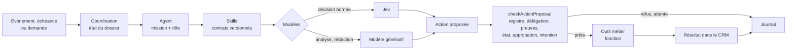

# Architecture

Le projet étend Upshift V1 par une **app** installée dans l'espace **ECC Upshift Agents**, plutôt que par un service séparé : c'est la recommandation du sujet (§02, §14). Agents, skills, rôles, outils et objets CRM sont déclarés dans ce dépôt, versionnés, puis synchronisés avec l'espace.

## Chaîne d'exécution

La sortie d'un modèle n'est qu'une **proposition**. Le serveur la contrôle avant toute écriture, quel que soit le modèle.

## Du sujet au code

| Élément du sujet | Primitive du SDK | Emplacement | Statut |
| --- | --- | --- | --- |
| Quatre agents (§08) | `defineAgent` | `src/agents/`, fiches dans `src/catalog/agents.ts` | prévu |
| Huit skills (§09) | `defineSkill` | `src/skills/`, contrats dans `src/catalog/skills.ts` | prévu |
| Délégation et permissions (§13) | `defineRole`, `defineApplicationRole` | `src/roles/` | prévu |
| Contrat d'action typé (§12) | code de l'app | `src/contracts/` | testé en unitaire |
| Outils métier | `defineLogicFunction` + `toolTriggerSettings` | `src/logic-functions/` | à créer |
| Déclencheurs (§05) | fonctions : événement de base de données, planification, route ; `runAgent()` | `src/logic-functions/` | à créer |
| CRM amélioré (§05) | `defineObject`, `defineField`, `defineView` | `src/objects/`, `src/fields/`, `src/views/` | à créer |
| Supervision (§07) | vues, pages, composants d'interface | à définir | à créer |
| Jev (§11) | fournisseur TypeSafe AI de l'espace, choisi par `modelId` | réglages IA de l'espace | prévu |
| Modèles génératifs (§12) | `modelId` de l'agent, réglages IA de l'espace | `src/models/providers.ts` | prévu |
| Clés des fournisseurs IA | réglages IA de l'espace, jamais dans le dépôt | — | à activer |

**Pourquoi les contrats vivent dans `src/catalog/`.** Le SDK ne relie pas explicitement un agent à ses skills (fonction encore en alpha). Le prompt de chaque agent est donc généré depuis sa fiche et cite chaque skill avec sa version : la même version et le même contrat apparaissent dans tous les agents qui l'utilisent, ce que demande la recette « Réutilisation ».

## Contrat d'action

Une proposition porte l'identifiant d'action et sa version de schéma, les paramètres, les préconditions (état attendu, références des preuves) et un identifiant d'intention. Elle ne porte ni son identité ni sa propre approbation.

Le contexte du contrôle vient uniquement de l'état du serveur : identité de l'exécution (organisation, délégant, agent, skill, modèle et leurs versions), délégation de l'agent, enregistrements et état courant du dossier, intentions déjà exécutées, références de preuves résolues dans le CRM et approbations enregistrées par les personnes habilitées. Le verdict reprend cette identité pour le journal.

`checkActionProposal` applique les contrôles dans cet ordre :

| Contrôle | Résultat en cas d'échec |
| --- | --- |
| Proposition bien formée (validée avant toute lecture) | refus `invalid-proposal` |
| Action présente dans le registre | refus `unknown-action` |
| Action non interdite | refus `forbidden-action`, même si un modèle ou un texte du CRM la recommande |
| Action déléguée à l'agent | refus `not-delegated` |
| Intention pas encore exécutée | `already-done` : un événement rejoué ne produit pas un second effet |
| Version du schéma | refus `schema-version-mismatch` |
| Paramètres valides (zod, à l'exécution) | refus `invalid-params` |
| Enregistrement visé appartenant au dossier contrôlé | refus `target-mismatch` |
| Preuves requises pour ces paramètres présentes (la pièce d'issue n'est exigée que pour « gagnée » ou « perdue ») | refus `missing-evidence` |
| Chaque référence de preuve résolue par le serveur dans le dossier, pour ce type de preuve | refus `unverified-evidence` |
| État attendu fourni pour toute modification d'un dossier existant, y compris un prospect rapproché | refus `missing-precondition` |
| État du dossier inchangé | refus `stale-state` : conflit visible |
| Approbation enregistrée pour ce contenu exact et cette intention | `awaiting-approval` ; toute modification exige une nouvelle approbation |

Catégories d'action (§13) : `consultation`, `bounded-change` (modification bornée), `external-contact`, `commercial-commitment`, `forbidden`. Le registre initial (`src/contracts/action-registry.ts`) couvre le cycle commercial ; ses paramètres sont un premier jet à affiner avec le processus métier.

## Jev

| Décision bornée | Primitive | Exemple |
| --- | --- | --- |
| Classer | Choice | Réponse : intéressé, objection, refus, information insuffisante |
| Évaluer | Score | Adéquation au profil, pertinence du besoin, signal d'intention, temporalité |
| Vérifier | Noul | La réponse contient-elle une demande de rendez-vous ? |

- **Accès** : Jev est le fournisseur intégré **TypeSafe AI** des réglages IA de l'espace, activé avec sa clé. Un agent le choisit avec `modelId` ; l'app n'appelle aucune API de modèle directement et ne stocke aucune clé.
- **Score** : les niveaux sont décrits du plus bas au plus haut ; Jev renvoie la moyenne des indices pondérée par les probabilités. Conversion vers 0–100 : `score / (niveaux − 1) × 100`. Un score hors de l'échelle ou une distribution incomplète n'est jamais utilisé.
- **Priorité** : pondérer les dimensions évaluées avec les poids versionnés de la grille. Une dimension inconnue est exclue et signalée, jamais comptée comme nulle ; la couverture et la confiance la plus basse s'affichent à côté.
- **Seuils** : agir, vérifier ou compléter selon la confiance. Les seuils se règlent sur les cas de calibrage, séparés des cas d'évaluation (§15). Une panne du fournisseur produit un état explicite, jamais un succès.

## Modèles génératifs

Dans Upshift, le modèle d'un agent se choisit avec `modelId` parmi les fournisseurs activés dans les réglages IA de l'espace. L'espace propose Anthropic, Google, Mistral, OpenAI, TypeSafe AI et xAI ; DeepSeek et Qwen, visés par le sujet, n'y figurent pas encore. Le MVP exige deux fournisseurs génératifs réellement testés sur un même contrat de skill ; `src/models/providers.ts` tient leur statut.

## Points à vérifier pendant l'audit

Ces points dépendent de l'espace ou de fonctions encore en alpha ; reportez le résultat dans [l'audit](audit-upshift-v1.md).

- La version d'Upshift déployée : l'app exige au moins **2.47** (version de l'espace le 22 octobre).
- La façon dont un agent utilise les skills de l'app (chargement, sélection).
- L'effet de `canAccessAllTools` sur l'accès des agents aux outils de l'app.
- Le format de `modelId` et les fournisseurs disponibles dans l'espace.
- Le droit de créer des enregistrements avec `canUpdateObjectRecords`.
