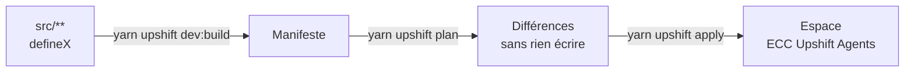

# SDK Upshift

Notre projet est une **app Upshift** : un paquet TypeScript qui déclare des objets, des fonctions, des rôles, des skills et des agents, puis les synchronise avec un espace. Cette page relie la documentation du SDK à notre dépôt.

> Les règles du SDK qui s'appliquent à ce dépôt sont dans [AGENTS.md](https://github.com/exceev-technology/upshift-agent/blob/main/AGENTS.md#règles-du-sdk-vérifiées-par-le-build-et-la-synchronisation) : lisez-les avant votre premier changement.

## Le principe

Chaque entité est un fichier dont l'instruction principale est `export default defineX({...})`. Le build trouve ces fichiers par analyse du code, puis produit un **manifeste** ; la synchronisation compare ce manifeste à l'espace et applique les différences.

| Entité | Fonction | Chez nous |
| --- | --- | --- |
| Application | `defineApplication` | `src/application-config.ts` |
| Rôle de l'app et rôles des agents | `defineApplicationRole`, `defineRole` | `src/roles/` |
| Objets, champs, relations | `defineObject`, `defineField` | à créer (`src/objects/`, `src/fields/`) |
| Vues, menus, pages | `defineView`, `defineNavigationMenuItem`, `definePageLayout` | à créer |
| Fonctions logiques et outils | `defineLogicFunction` (+ `toolTriggerSettings`) | `src/logic-functions/` |
| Skills | `defineSkill` | `src/skills/`, contrats dans `src/catalog/skills.ts` |
| Agents | `defineAgent` | `src/agents/`, fiches dans `src/catalog/agents.ts` |

Correspondance détaillée avec le sujet : [architecture](https://github.com/exceev-technology/upshift-agent/blob/main/docs/architecture.md).

## La CLI

Dans ce dépôt, toutes les commandes passent par `yarn upshift <commande>`.

| Commande | Effet |
| --- | --- |
| `dev:build` | Construit l'app et vérifie le manifeste (sans serveur) |
| `dev:add <type>` | Génère une entité (`object`, `field`, `logicFunction`, `role`, `skill`, `agent`, `view`…) ; à lancer dans un terminal interactif |
| `remote:add --url <url> --as ecc` | Relie la CLI à un espace (adresse et clé fournies par l'encadrement) |
| `remote:list`, `remote:use`, `remote:status` | Gère les espaces reliés |
| `plan` | Montre ce que la synchronisation changerait, **sans rien écrire** |
| `apply` | Synchronise l'espace actif avec la source |
| `dev:function:exec -n <nom> -p '{…}'` | Exécute une fonction |
| `dev:function:logs` | Suit les journaux des fonctions |
| `docker:start`, `docker:stop`, `docker:status`, `docker:logs` | Serveur Upshift local |

Référence : [CLI](https://docs.upshiftcloud.com/en/developers/extend/apps/operations/cli) · [serveur local](https://docs.upshiftcloud.com/en/developers/extend/apps/getting-started/local-server).

## Les règles qui évitent les mauvaises surprises

- **Relisez toujours `plan` avant `apply`.** `apply` supprime toute entité que la source ne déclare plus, avec ses données. Utilisez `--no-delete` si la source est volontairement partielle.
- **Ne changez jamais un `universalIdentifier` déjà synchronisé** : le serveur voit une suppression puis une création, et les données partent avec la suppression. Un nouvel identifiant se génère avec `crypto.randomUUID()`, jamais à la main.
- **Une seule synchronisation à la fois par espace.** Prévenez dans le canal avant un `apply` sur ECC Upshift Agents.
- **Le rôle d'un agent ne peut pas dépasser celui de l'app** : le build échoue sinon.
- **Aucune variable réservée** (URL d'API, jetons, clé d'API) dans la configuration de l'app.
- En cas de blocage de synchronisation, suivez l'échelle de [synchronisation et récupération](https://docs.upshiftcloud.com/en/developers/extend/apps/operations/sync-and-recovery) et demandez avant tout `docker:reset`.

## Fonctions, outils, skills et agents

- Une **fonction logique** reçoit `(payload, context)`. `CoreApiClient` agit au nom de la personne qui a déclenché l'exécution, dans la limite du rôle de l'app.
- Une fonction devient un **outil** d'agent avec `toolTriggerSettings`, et une action de workflow avec `workflowActionTriggerSettings`. L'agent choisit ses outils d'après leur `description` : soignez-la.
- **Skills et agents** sont encore *alpha* dans le SDK. Un agent a un `prompt`, un `modelId` et un rôle ; notre catalogue génère le prompt depuis la fiche de l'agent et cite chaque skill avec sa version.
- **Chez nous, toute écriture passe par `checkActionProposal`** avant exécution (`src/contracts/action.ts`). Voir [MCP et agents autonomes](MCP-et-agents-autonomes.md).

## Parcours de lecture : la documentation développeur

1. [Démarrage rapide](https://docs.upshiftcloud.com/en/developers/extend/apps/getting-started/quick-start), [concepts](https://docs.upshiftcloud.com/en/developers/extend/apps/getting-started/concepts), [structure du projet](https://docs.upshiftcloud.com/en/developers/extend/apps/getting-started/project-structure)
2. [Configuration de l'app](https://docs.upshiftcloud.com/en/developers/extend/apps/config/application), [rôles](https://docs.upshiftcloud.com/en/developers/extend/apps/config/roles)
3. [Objets](https://docs.upshiftcloud.com/en/developers/extend/apps/data/objects), [relations](https://docs.upshiftcloud.com/en/developers/extend/apps/data/relations)
4. [Fonctions logiques](https://docs.upshiftcloud.com/en/developers/extend/apps/logic/logic-functions), [skills et agents](https://docs.upshiftcloud.com/en/developers/extend/apps/logic/skills-and-agents), [workflows livrés par une app](https://docs.upshiftcloud.com/en/developers/extend/apps/logic/workflows)
5. Le [tutoriel d'agent](https://docs.upshiftcloud.com/en/developers/extend/apps/tutorials/document-generator/ai-agent)
6. [Tests](https://docs.upshiftcloud.com/en/developers/extend/apps/operations/testing), [bonnes pratiques](https://docs.upshiftcloud.com/en/developers/extend/apps/getting-started/good-practices), [dépannage](https://docs.upshiftcloud.com/en/developers/extend/apps/getting-started/troubleshooting)
7. [API REST et GraphQL](https://docs.upshiftcloud.com/en/developers/extend/api), [webhooks](https://docs.upshiftcloud.com/en/developers/extend/webhooks)

## Exercices

1. Lancez `yarn upshift dev:build`, puis ouvrez le manifeste produit dans le dossier de sortie qu'affiche la commande. Retrouvez-y un agent et un skill.
2. Lisez `src/catalog/skills.ts` et `src/catalog/render.ts` : comment le contenu d'un skill est-il produit ? Que se passe-t-il quand on change sa `version` ?
3. Lisez `src/contracts/action.ts` et ses tests : citez trois cas où une proposition est refusée.
4. Avec un serveur local (`yarn upshift docker:start`), reliez la CLI, lancez `plan` et lisez le résultat sans lancer `apply`.
