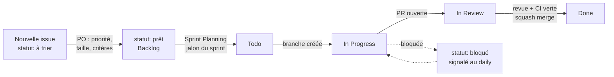

# Scrum dans GitHub

Un Scrum allégé, outillé entièrement dans GitHub. Première expérience de Scrum pour la plupart d'entre nous : on garde le minimum utile, et on l'applique vraiment.

## Scrum en cinq minutes

Scrum découpe le travail en **sprints** courts (ici une semaine). À chaque sprint, l'équipe s'engage sur un **objectif**, réalise un **incrément** démontrable, le montre au Product Owner, puis ajuste. Trois rôles (Product Owner, Scrum Master, équipe de développement), quatre cérémonies (planning, daily, review, rétrospective), trois artefacts (product backlog, sprint backlog, incrément).

## Chaque notion a sa place dans GitHub

| Scrum | Dans GitHub |
| --- | --- |
| Product backlog | Les [issues](https://github.com/exceev-technology/upshift-agent/issues) ouvertes, colonne **Backlog** du [tableau](https://github.com/orgs/exceev-technology/projects/2), triées par libellé `priorité:` |
| Story utilisateur | Une issue **Fonctionnalité** : « En tant que…, je veux…, afin de… » + critères d'acceptation |
| Tâche technique | Une issue **Tâche**, ou une sous-issue d'une story |
| Défaut | Une issue **Bug** |
| Estimation | Le libellé `taille:` (XS à XL). XL = à découper avant le sprint |
| Definition of Ready | Le libellé `statut: prêt` : claire, estimée, critères d'acceptation écrits |
| Sprint | Un [jalon](https://github.com/exceev-technology/upshift-agent/milestones) « Sprint N · … », avec sa date de fin (et le champ *Sprint* du tableau) |
| Sprint backlog | Les issues du jalon, colonne **Todo** |
| Burndown | La barre d'avancement du jalon et l'onglet *Insights* du tableau |
| Incrément | Les pull requests fusionnées sur `main` pendant le sprint |
| Sprint Planning | Une discussion **Announcements** « Planning » |
| Daily | Un fil Slack par jour |
| Sprint Review | Visio de 30 min + discussion **Announcements** « Récap » ; démos dans **Show and tell** |
| Rétrospective | En fin de review : une discussion **Announcements** « Rétrospective » |
| Definition of Done | [La page dédiée](Definition-of-Done.md), rappelée dans le modèle de PR |

## Le tableau

| Colonne | Signifie | Qui y déplace la carte |
| --- | --- | --- |
| **Backlog** | Connu, pas encore planifié | Le Product Owner, au tri |
| **Todo** | Retenu pour le sprint en cours | L'équipe, en Sprint Planning |
| **In Progress** | Quelqu'un y travaille, une branche existe | La personne assignée |
| **In Review** | Une pull request attend une revue | La personne assignée |
| **Done** | Fusionné, et conforme à la Definition of Done | Automatique à la fermeture de l'issue |

Règles simples :

- **Pas plus de deux cartes « In Progress » par personne.** Finir avant de commencer.
- Une carte « In Progress » sans mouvement depuis 2 jours se signale au daily.
- Une issue fermée sans PR fusionnée doit dire pourquoi en commentaire.

## La vie d'une issue

## Les cérémonies

Sprints d'une semaine, **du jeudi au mercredi**.

| Cérémonie | Quand | Qui | Comment, dans GitHub |
| --- | --- | --- | --- |
| **Sprint Planning** | Jeudi, 1er jour | Toute l'équipe, PO présent | Le responsable de la semaine publie dans **Announcements** l'objectif du sprint et 3 à 5 issues, chacune avec une personne responsable. Les issues reçoivent le jalon et passent en **Todo**. Le PO valide ou ajuste. |
| **Daily** | Chaque jour ouvré | Chaque membre | Un fil Slack par jour, ouvert par le responsable de la semaine. Chacun répond avec le modèle ci-dessous et cite ses issues (`#12`). |
| **Sprint Review** | Mercredi, dernier jour | Équipe, PO, encadrement | Visio de 30 min : démo de ce qui fonctionne, sur l'espace ECC Upshift Agents, avec des données fictives. Le récap va dans **Announcements**. |
| **Rétrospective** | Juste après la review, 10 min | Équipe | Trois questions : ce qui a marché, ce qui a coincé, ce qu'on change. Une action concrète au plus, assignée. |

**Modèle de daily**

> ✅ Hier : #12 grille de score relue, PR #15 ouverte
>
> 🎯 Aujourd'hui : corriger les retours de #15, commencer #18
>
> 🚧 Blocage : aucun / …

## Les rôles dans GitHub

**Product Owner**
- Trie les nouvelles issues (`statut: à trier`) au moins deux fois par semaine : priorité, critères d'acceptation, `statut: prêt` ou fermeture motivée.
- Ordonne la colonne Backlog : ce qui est en haut passe en premier.
- Accepte ou refuse en review, au regard des critères d'acceptation.

**Responsable de la semaine (Scrum Master)**
- Publie le planning du jeudi et le récap du mercredi dans Discussions.
- Ouvre le fil du daily chaque matin.
- Vérifie le tableau : cartes bloquées, cartes sans responsable, PR en attente de revue depuis plus de 24 h.
- Crée la version de fin de sprint avec l'encadrement : un tag `v0.N.0` et des notes générées automatiquement.

**Équipe de développement**
- S'assigne les issues, tient ses cartes à jour, relit les PR des autres.
- Découpe les tâches trop grosses, signale tôt ce qui bloque.

## Bonnes pratiques

- **Découpez** en tâches de 1 à 2 jours. Une story qui dépasse le sprint se découpe en sous-issues.
- **Un skill qui marche en démo vaut mieux que trois à moitié finis.**
- **Relire est du travail du sprint.** Une PR qui attend une revue bloque une personne.
- **Il est normal de ne pas tout finir** : on ajuste les priorités à chaque review, et ce qui n'est pas fini retourne au Backlog avec un commentaire.
- **Tout ce qui est décidé à l'oral s'écrit** : dans l'issue, la discussion ou la PR concernée.

## Pour aller plus loin

- [Le guide Scrum](https://scrumguides.org/scrum-guide.html) (13 pages, la référence)
- [Planifier et suivre son travail avec GitHub Projects](https://docs.github.com/fr/issues/planning-and-tracking-with-projects/learning-about-projects/about-projects)
- [Les jalons](https://docs.github.com/fr/issues/using-labels-and-milestones-to-track-work/about-milestones) et [les sous-issues](https://docs.github.com/fr/issues/tracking-your-work-with-issues/using-issues/adding-sub-issues)
